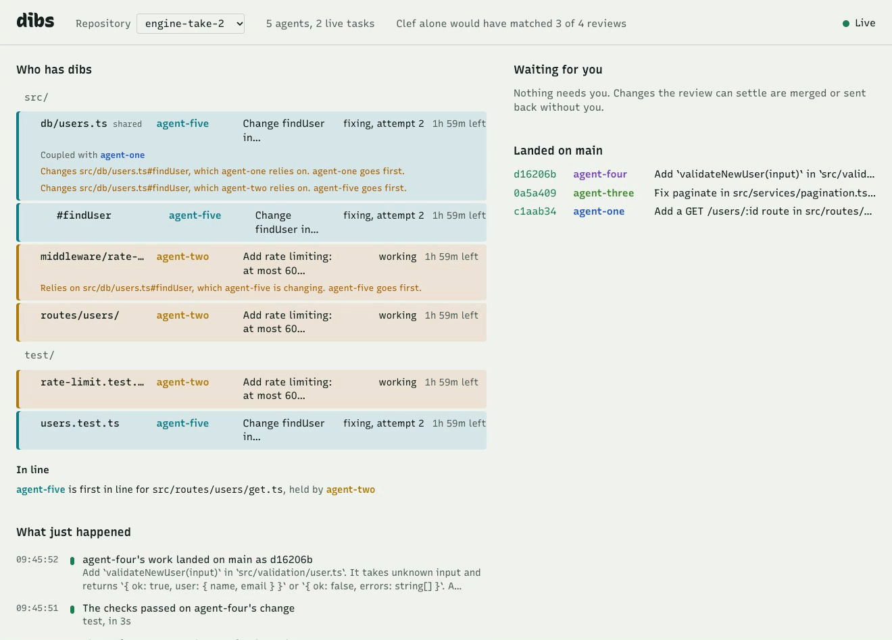
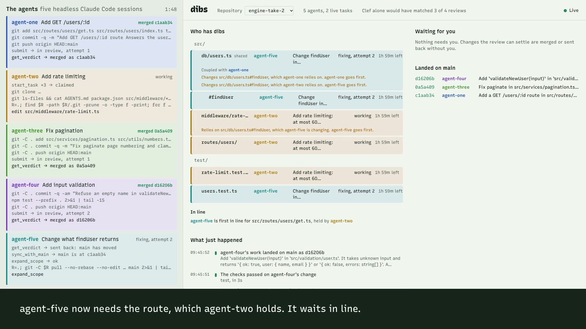

# dibs

A git engine for many coding agents working on one repository at the same time. Built on Cloudflare Workers, Durable Objects, Containers and [Artifacts](https://developers.cloudflare.com/artifacts/).

Before it writes a line, an agent tells dibs what it will change, what it will only add to, and what it relies on. Two agents that want to change the same code are told at that moment, and one of them can wait in line for it. Two whose work meets are both told: one changes `findUser`, the other calls it. When the work is done there is no pull request. dibs runs the repository's own checks on the change joined with the current `main`, has a reviewer model judge it, and lands it, or sends it back with the exact reason and what to do.

One rule keeps `main` whole however many agents land at once: **no file on `main` uses an interface in a shape it was not written for.** It is checked mechanically, from an index of what every file exports and imports, before the review and again under the merge lock. A person is asked only what only a person can decide.

**Demo video (7:55):** [dibs-demo.mp4](https://github.com/shivamsriva31093/dibs/releases/download/v1.0.0/dibs-demo.mp4), a real run of five Claude Code agents on a deployed Worker, with [the narration as text](https://github.com/shivamsriva31093/dibs/releases/download/v1.0.0/dibs-demo-narration.md). To run dibs yourself, on your machine or on your Cloudflare account, see [Run it](#run-it).



*The board during a real run of the demo on a deployed Worker: five Claude Code agents on one repository. Three changes have landed. agent-five's change to `findUser` was sent back because agent-one's route, which uses it, landed first; it now waits in line for that route, which agent-two holds. Nothing is waiting for a person.*

## Why

Git and pull requests assume a few people who each work for hours and who talk to each other. Put twenty agents on one repository and that stops working:

- **Intent is invisible until the work is done.** Two agents rewrite the same file, and neither knows until one of them tries to merge.
- **Collisions show up last, and the real ones are not textual.** One agent changes what `findUser` returns while another writes a route that calls it. The files differ, the merge is clean, and `main` is broken.
- **A person reviews everything.** Agents produce changes faster than people can read them, so the review queue sets the pace.

dibs moves intent to the start and makes it binding, checks what can be checked by running and indexing code rather than by reading it, and leaves a person the decisions that need one.

| | How intent is known | When a collision shows | Who decides the merge |
|---|---|---|---|
| Pull requests | The description, written after the work | At merge time, and only a textual one | A person |
| Merge queues | The description | When the merged tests fail | The tests, then a person |
| [Entire](https://entire.io) | Reconstructed afterwards from captured agent sessions | Not covered by what has shipped | A person; its review is advisory |
| **dibs** | Declared before the work, enforced, and filled in from the code | Before the work starts, and again at each later point where more is known | The platform, from the checks, the index and a verdict; a person when a rule says so |

dibs does not capture sessions, and it has no blame or search. Entire does those. The two fit together: dibs copies every trailer it finds on an agent's commits onto the merge commit, so a checkpoint link survives the merge, and it keeps every task's fork.

## How it works

```
 coding agents (Claude Code, Codex, ...)            a person
      │  MCP over HTTP        │ git clone / push      │ browser
      ▼                       ▼                       ▼
 ┌──────────────── Worker: dibs ─────────────────────────────┐
 │  /mcp/<repo>       /api/...          / (the board)        │
 └──────┬─────────────────┬──────────────────────────────────┘
        ▼                 ▼
 ┌─ Coordinator (Durable Object, one per repo) ──────────┐
 │  SQLite: scopes, the line, the interface index,        │──▶ WebSocket to the board
 │  collisions, submissions, verdicts, events, the lock   │
 └──────┬─────────────────────────────────────────────────┘
        │ starts
        ▼
 ┌─ ReviewWorkflow (one run per submission) ───────────┐      ┌─ Artifacts ──────────────┐
 │ changes → scope check → interfaces → contracts →     │◀────▶│ the main repo            │
 │ diff → checks (gate) → triage → review → decide →    │      │ hidden candidate refs    │
 │ lock → contracts → candidate → (gate) → land         │      │ one fork per task        │
 └──────┬──────────────────────┬────────────────────────┘      └──────────────────────────┘
        ▼                      ▼
   Workers AI: Clef     GateRunner (Durable Object + Container): the repo's own checks
   Anthropic: reviewer
```

### 1. Scope

An agent calls `start_task` with its goal and its **scope**: a list of targets, each held in one of three ways.

| Relation | Means | Two tasks at once |
|---|---|---|
| `change` | The task rewrites it. A path, a directory (ending in `/`), or one interface written `path#name`, such as `src/users.ts#findUser` | Never on the same code |
| `add` | The task only adds to it: a list of routes, an index, a directory of tests | Both may; dibs joins their additions when they land |
| `rely` | The task uses it and will not touch it | Never refused; but whoever changes it and whoever relies on it are told of each other at once |

`paths` is still accepted, and means paths to change. Holding one interface of a file to change, and the file to add to, is how two tasks work on different functions of the same file.

The scope is checked and recorded in one step of the repository's Coordinator, a Durable Object, with nothing awaited in between: two agents asking for the same code at the same instant get exactly one grant.

- **Granted:** the agent receives a private fork and a write token for that fork and nothing else.
- **Refused:** it is told which task holds what, how, and until when. It can ask for less, ask to add where it only adds, or **wait in line**: with `wait_seconds`, the call waits and answers with a `request_id` to keep waiting on. A waiting request holds nothing meanwhile. It is granted whole, in order of arrival, the moment what it waits for is free. A wait that could never end (two tasks each waiting for what the other holds) is refused.

**What a task relies on is filled in for it.** dibs keeps an index of every TypeScript and JavaScript file of `main`: the interfaces it exports, each with a hash of its signature, and the names it imports from other files, followed through re-exports and `export *` barrels. When a task is granted `src/routes/users/`, dibs adds to its scope, as relied on, every interface those files import. The index is built when a repository is registered and updated from the files as each change lands.

So the collision that matters is found without a model. When agent-five asks to change `src/db/users.ts#findUser` and agent-one's route imports it, both are told before either has written a line: who changes what the other uses, which of the two is expected to land first, and what each should do. An agent can read the other's work in progress with `peek`. Decision-model warnings (Clef: independent, coupled, a duplicate) still run, at `start_task` and again at `expand_scope`, for the coupling no import shows. A task told it repeats an earlier one has to say how it differs before it can submit.

A scope lasts 120 minutes without activity (up to 480 on request) and does not run out while its task is being reviewed or checked.

### 2. Work

Plain git. The agent clones its fork, commits, and pushes to it. It cannot push to the main repository: no token for it ever leaves dibs. If it finds it must touch more, it calls `expand_scope`. If it finds it is changing what a function takes or returns, it says so with `declare_interface_change`, and the tasks that use it are told while they can still adapt cheaply.

### 3. Review

The agent calls `submit`, which pins the fork's head, and then `get_verdict`, which waits: for the checks, the review, and a person when one is deciding. A Cloudflare Workflow runs these steps, each one durable and retried:

| Step | What happens | Who decides |
|---|---|---|
| Changes | The changed paths, found by walking the two trees | Code |
| Scope | Every changed path must be in the scope to change or to add to. The change must not be empty. More than 50 files, more than 100 KB of diff, or a binary file goes to a person | Code |
| Interfaces | Which interfaces the change adds, removes or gives another signature, and what the changed files use, each with its signature where the fork branched off `main` | Code, from the index |
| Contracts | The change goes back, before any model is asked, if something it relies on is no longer what it was (**C1**), or if it alters an interface and leaves a file on `main` that uses it as it was (**C2**) | Code |
| Checks | The repository's own commands from `.dibs/checks.json` (say `npm test`), run in a fresh container on the change joined with the current `main`. A failure goes back with the failing output | The repository's tests |
| Triage | Five typed questions to [Clef](https://developers.cloudflare.com/workers-ai/): goal fit, risk, unrelated changes, interface change, leftovers | A decision model, as signals only |
| Review | Goal, scope, diff, signals, the checks' results, what dibs found about interfaces and the other tasks, and the repo's `AGENTS.md` go to Claude, which returns a verdict with issues. It can read and search the repository at the submitted commit, and it is told what the previous attempt was sent back for | A reviewer model |
| Decide | The rules below | Code |

The decision rules, first match wins:

1. The reviewer rejects, or approves with a critical issue: back to the agent with the issues. On the third rejection, to a person.
2. The reviewer cannot judge it: to a person.
3. A protected path changed (`package.json`, `wrangler.jsonc`, `.github/`, `.dibs/`, `migrations/` and others; set per repo): to a person.
4. A real chance, by the triage, that the change is high risk: to a person.
5. The change alters an interface and leaves files that use it as they were, on the agent's word that they need no change (`leaves_dependents`), and no checks passed to back that word: to a person. Where the index cannot see the code, Clef's interface-change signal stands in for this rule.
6. Otherwise: merge.

So a person sees changes the reviewer could not judge, protected paths, and the few claims nobody could check.

Every send-back counts as an attempt, whatever sent it: the scope check, the contract checks before review or at landing, the tests, a `main` that moved under a held path, or the reviewer. On the last allowed attempt (`max_cycles`, three by default) the change goes to a person instead of back to the agent, with what it was last sent back for. An agent that cannot adapt is stopped after three tries, not left to loop until its scope runs out.

### 4. Land

With the merge lock held, dibs looks again: C1 and C2 against the index as it is now. Then it builds the commit that would land, the **candidate**, and pushes it to a hidden ref of the main repository, `refs/dibs/candidates/<task>`. If `main` moved since the checks ran, the candidate holds another tree, and the checks run again on it. Only then does `main` move, to that very commit: the tree that lands is a tree the checks passed on.

Artifacts has no server-side merge, and a Worker has no git. So dibs does it from first principles, with no clone:

1. Read only the trees along the changed paths, through the Artifacts binding.
2. For a path the task holds to change, `main` must still hold what the fork started from; otherwise the scope lapsed at some point and the work goes back to catch up. A path the task holds to **add to** may have been added to by others meanwhile: dibs joins the two with a three-way merge of the file (both sides' additions kept, ours after theirs, and two lines that both only added to are joined word by word), and refuses anything else as a conflict.
3. Build the blob, tree and commit objects, hash them, write them into a packfile, and push it over git's own HTTP protocol, naming the commit it was built on. If `main` moved, the push is refused.

A merge sends only the objects that are new, so its cost follows the size of the change, not of the repository. `src/git/` has no dependencies, and the tests check it against the real git: objects against `git hash-object` and `git write-tree`, packs with `git fsck`, merged trees against `git merge-tree`, joined files against `git merge-file`, and pushes against a real `git http-backend`.

### Why main stays whole

C1 and C2 make the landing order safe either way. If the task that relies on `findUser` lands first, the task that changes it fails C2: the new route on `main` uses `findUser` and is not part of the change, so it is told to take that file into its scope and update it. If the change to `findUser` lands first, the route fails C1: what it relies on is not what it was, so it is told to catch up and adapt. Neither needs a person. The order dibs suggests, in each task's `collisions`, only saves one of them some rework.

What C1 and C2 cannot see, the checks can: two changes whose signatures agree and whose behaviour does not. That is why the checks run on the change joined with `main`, and again at landing if `main` moved.

### The checks

A repository declares its checks in `.dibs/checks.json`:

```json
{ "setup": "npm ci", "checks": [{ "name": "test", "run": "npm test" }], "timeout_seconds": 300 }
```

Each run has its own Durable Object and a fresh container, started from `gate/Dockerfile` (Node.js and git) and destroyed afterwards. The container fetches the candidate from its hidden ref. **No secret enters it:** its git requests to Artifacts are taken by a Worker entrypoint, `GitGateway`, built for that one repository, which lets through reads of it and nothing else and adds a short-lived token on the way. Unless the repository sets `"internet": true` (an `npm ci` needs it), the container can reach nothing else at all, so the code under check cannot send anything anywhere.

A repository without the file has no checks, and dibs works as it did before them. When the checks cannot run, the review goes on without them and the commit says so.

### Catching up with main

A fork does not follow `main`. When a verdict says that something the task relies on has changed, the agent calls `sync_with_main`. It gets a read-only token for the main repository, good for ten minutes, and a `git pull` command that merges the current `main` into its fork. At the next `submit`, dibs takes as the task's base the newest commit of `main` that the fork contains, so the review sees the task's own change and not everything that came in with the merge.

### What lands in git

One commit per task on `main`, written by the agent and committed by dibs:

```
Change findUser to return a result object

findUser returns a result object; the route that uses it is updated.

Dibs-Task: t-aab0pwyi
Dibs-Agent: agent-five
Dibs-Claim: src/db/users.ts, src/routes/users/get.ts, test/users.test.ts
Dibs-Scope: change=src/db/users.ts, src/db/users.ts#findUser (detected), src/routes/users/get.ts, test/users.test.ts; rely=src/db/client.ts#User (inferred), src/db/client.ts#db (inferred), src/router.ts#Route (inferred)
Dibs-Interfaces: src/db/users.ts#findUser (changed)
Dibs-Gate: pass; test; 4s
Dibs-Verdict: approve; reviewer=claude-opus-5-5; cycle=2
Dibs-Fork: e2e-mursuzg8--t-aab0pwyi@1023d851…
```

`Dibs-Composed` names any file that was joined with what other tasks added to it. The full record (the scope with where each entry came from, each altered interface's signature before and after, the collisions, the checks with their output, the reviewer's verdict and lookups, who approved) is attached to the commit as a git note under `refs/notes/dibs`. Both travel with every clone, so why a change landed does not depend on dibs.

### The decision model

Cloudflare's Clef answers typed questions with probabilities and writes no text. dibs uses it in two places, the related-work warning and the triage, and in both it only informs. It never refuses a claim and it never approves a merge. Where the index can speak for a change, Clef's interface-change probability is no longer a reason to ask a person.

The thresholds come from Clef's answers on ten cases, five of them real diffs: [what Clef answered](docs/clef-calibration.md). One finding there is worth knowing if you use Clef yourself: its `confidence` is not the probability of its answer.

Every verdict also records whether Clef alone would have approved the change. The board shows how often that matched the final outcome: the evidence you would want before letting a decision model skip the reviewer, which dibs does not do.

## Run it

### On your own machine, without a Cloudflare account

```sh
pnpm install
pnpm local
```

This runs the real Worker, its Durable Objects and its Workflow under `wrangler dev`, next to a stand-in for the three services that cannot run on a laptop. It needs Node 22.18 or later, pnpm and git, and nothing else: no account and no keys.

| Service | Stand-in |
|---|---|
| Artifacts | Real bare repositories served by `git http-backend`, behind the binding's own methods, error codes and repo-scoped tokens |
| Clef | Fixed rules: two tasks are coupled when their goals name the same identifier; a diff that rewrites an exported declaration is an interface change |
| The reviewer | Approves everything. `pnpm local --real-reviewer` uses the real model instead; it needs `ANTHROPIC_API_KEY` and sends the diffs under review to Anthropic |

It prints the address of the board and an admin token made up for that run. Everything below under "Register a repository", "Run the demo" and "Check a deployment" works against it unchanged: point `DIBS_URL` at it.

The stand-ins show that dibs's own code hangs together, from the MCP call to the commit on `main`, the scopes, the line and the index included. They say nothing about how the real services behave, and a change the stand-in reviewer passes has not been reviewed. A local run has no containers, so it runs no checks: the review goes on without them, as it does for a repository without `.dibs/checks.json`.

### What you need to deploy

- A Cloudflare account on the Workers Paid plan, which includes Containers. Artifacts is in beta and is billed from 14 October 2026.
- An Anthropic API key, for the reviewer.
- Node 22.18 or later, pnpm, and git.
- Docker, running: a deploy builds the image the checks run in (`gate/Dockerfile`). If the build hangs while pulling the base image, Docker's credential helper is the usual cause; a `DOCKER_CONFIG` directory whose `config.json` names no helper gets past it.

### Deploy

```sh
pnpm install
pnpm exec wrangler login

cp .dev.vars.example .dev.vars      # then put the two values in it
pnpm run deploy:first
```

`.dev.vars` holds two secrets: `ADMIN_TOKEN`, a long random string of your choosing that guards the API and the board, and `ANTHROPIC_API_KEY`. Wrangler will not create a Worker whose required secrets are missing, so the first deploy uploads them from that file. Later deploys are `pnpm run deploy`. (Use `pnpm run deploy`, not `pnpm deploy`, which is a different pnpm command.)

The deploy creates the Durable Objects, the Workflow and the container application for the checks. Artifacts creates the `dibs` namespace when the first repository is registered. There is nothing else to set up.

A Durable Object's storage cannot be taken back to an earlier version of dibs: once a repository has been used by this version, its scopes are stored in a shape the first version cannot read.

### Register a repository and its agents

```sh
export DIBS_URL=https://dibs.<your-subdomain>.workers.dev
export DIBS_ADMIN_TOKEN=<the ADMIN_TOKEN you chose>

node scripts/setup-demo.ts
```

This registers a new repository holding the contents of `demo-app/`, creates five agents, and writes each agent's key and MCP configuration to `.demo/<repo>/`. It prints the repository's name and the address of its board. `demo-app/` has a `.dibs/checks.json` that runs `npm test`, so on a deployment every change to it is tested before it lands.

Or do it by hand:

```sh
# A new repository from files, or pass "import_url" with an https git URL instead of "files".
curl -X POST "$DIBS_URL/api/repos" -H "Authorization: Bearer $DIBS_ADMIN_TOKEN" \
  -H "Content-Type: application/json" \
  -d '{"name": "my-repo", "files": {"README.md": "# my repo\n"}}'

# An agent. Its key is shown once.
curl -X POST "$DIBS_URL/api/repos/my-repo/agents" -H "Authorization: Bearer $DIBS_ADMIN_TOKEN" \
  -H "Content-Type: application/json" -d '{"name": "agent-one"}'
```

Registering a repository also reads it into the interface index. `index` in the answer counts the files, interfaces and references read, and `unread` the source files left out: it reads at most 400 at once, and a file left out is read when a change to it lands. `POST /api/repos/<repo>/index` reads the repository again from the start.

### Connect an agent

Any agent with an MCP client can use dibs. The endpoint is `<DIBS_URL>/mcp/<repo>`, over Streamable HTTP, with the agent's key as a bearer token:

```json
{
  "mcpServers": {
    "dibs": {
      "type": "http",
      "url": "https://dibs.<your-subdomain>.workers.dev/mcp/my-repo",
      "headers": { "Authorization": "Bearer <agent key>" }
    }
  }
}
```

With Claude Code: `claude --mcp-config .demo/<repo>/agent-one.mcp.json`. The tool descriptions teach the agent the loop, so the prompt only needs the task.

| Tool | What it does |
|---|---|
| `start_task` | Declares a goal and a scope (`paths`, or `scope` entries to change, add to or rely on). Returns a fork, a token and ready-made clone and push commands; or the tasks that hold what it asked for; or, with `wait_seconds`, a place in line |
| `expand_scope` | Adds to a task's scope, with the same answers and the same line. `expand_claim` is its older name and still works |
| `declare_interface_change` | Says the task will alter an interface such as `src/db/users.ts#findUser`. The tasks that use it are told at once, and the answer lists the files that use it (`dependents`) |
| `peek` | Reads the work in progress of a task this one collides with: its goal, files and diff, from its fork |
| `submit` | Sends the fork's head for review |
| `get_verdict` | The task's state and its latest verdict. While the checks or a review are running, or a person is deciding, the call waits, so an agent needs no way to pause |
| `sync_with_main` | Returns a read-only token for the main repository and a `git pull` command that merges the current `main` into the fork |
| `whats_happening` | What every agent is working on, the requests waiting in line, and recent merges |
| `abandon` | Gives up a task and frees what it holds, or gives up a place in line |

Most answers also carry `collisions`, other tasks whose work meets this one, each with a `brief` that says what to do; `dependents`, for each interface the task changes, the files that use it and are not the task's to write; and `related`, Clef's view of which tasks are connected, including ones that started later.

### Run the demo

```sh
scripts/demo.sh <repo>
```

This starts five headless Claude Code sessions at once, each with its own key, working directory and goal (`scripts/prompts/`). It needs the `claude` command and Node 22.18 or later on the PATH. The agents start without your own Claude Code settings, plugins and `CLAUDE.md`, so that what they do depends only on their prompt and on dibs.

Open the board at `<DIBS_URL>/?repo=<repo>` and paste the admin token. The goals are chosen so that the board shows each path through the system:

| Agent | Goal | What you should see |
|---|---|---|
| one | Add `GET /users/:id`, which calls `findUser` | Changes the route file, adds to the list of user routes, relies on `findUser`. dibs fills in the rest of what it relies on |
| two | Add rate limiting, and apply it to every user route | Asks to change `src/routes/users/`, which agent-one holds, and waits in line. It is granted the routes the moment agent-one lands |
| three | Fix pagination, starting with `src/services/` | The second cause is in `src/utils/numbers.ts`, outside its scope. It expands its scope first, or the scope check sends it back and it expands it then |
| four | Add input validation, and break a test in its first attempt on purpose | The checks run its tests in a container, and the change goes back with the failing output before any model reads it. The fix lands |
| five | Change what `findUser` returns | Both agent-five and agent-one are told of the collision before either writes a line, without a model. Whichever lands second is sent back by the contract check, C1 or C2, catches up with `main`, adapts and lands. No person is needed |

What the models do is not scripted, so a run can differ from this table. The line, the collision and the contract and scope checks are decided by code, and the tests decide the rest.

### Record the demo as a video

```sh
node video/record.ts <new-repo-name>     # registers the repository, runs the five agents, films the run
node video/build.ts <new-repo-name>      # puts the video together in video/out/
```

`record.ts` films a real run: what each agent is doing, read from its session log, next to the live board, with the narration as captions. The agents, the checks, the reviews and the merges are whatever happens, and the narration follows them. If a change goes to a person, the script approves it, and the narration says that the script did. `build.ts` adds the cards before and after the run, among them `git log`, the trailers and the note of what landed, read back with plain git.



*A frame of the recording: the five agents on the left, the live board on the right, the narration underneath.*

Both need Google Chrome and `ffmpeg`. Nothing an agent is handed appears in the picture: a step is described from its name and a few chosen fields, and commands are shown without their credentials and addresses (`video/agent-log.ts`, with tests).

The narration is spoken by [Fish Audio](https://fish.audio) when it has a key, and by the `say` command of macOS when it has none:

```sh
export FISH_API_KEY=...            # or FISH_ENV_FILE=<a file with a line FISH_API_KEY=...>
export DIBS_FISH_VOICE=<id>        # optional: a Fish voice (reference_id) of your own
```

The lines follow what happens in the run, so they are spoken as the run is filmed; the ones a run is likely to need are spoken before it starts. Every clip is kept in `video/out/voice/` under the name of its words and its voice, so a line is paid for once. `video/pronunciations.json` holds the few words that are said differently from how they are written. Captions keep the written form.

### Check a deployment end to end

```sh
node scripts/e2e.ts
```

This drives the same scenario with scripted git pushes in place of real agents, against the real Artifacts, the real Clef, the real reviewer and, on a deployment, the real containers. It asserts the outcomes that code decides: the index read at registration, the refused scope and the wait in line, the collision over `findUser` told to both tasks, the scope check, the change to `findUser` sent back by the contract check and then landing, and that a change to `package.json` never merges without a person. It asks the git server whether it refuses a push built on an out-of-date head, requires every review to finish, approves what was escalated, and clones `main` with plain git to check the commits, their trailers, the note and `git fsck`. Then a task that started early catches up with `sync_with_main`, and its review must see its own change alone; where checks run, a change that breaks a test must come back with the test named, before any model sees it; and two tasks add a route each to the same list at once, and both routes must be on `main`.

### Look at the result with your own git

```sh
curl -X POST "$DIBS_URL/api/repos/<repo>/read-token" -H "Authorization: Bearer $DIBS_ADMIN_TOKEN"
# run the clone_command it returns, then:
git log
git fetch origin refs/notes/dibs:refs/notes/dibs && git notes --ref=dibs show HEAD
```

The token is read-only and lasts an hour. Writing to `main` stays with dibs.

### Settings

Per repository, in the body of `POST /api/repos`:

| Field | Default | Meaning |
|---|---|---|
| `protected_paths` | `.dibs/`, `.github/`, `wrangler.jsonc`, `wrangler.toml`, `package.json`, `package-lock.json`, `pnpm-lock.yaml`, `.env`, `migrations/` | A change to any of these goes to a person |
| `max_cycles` | 3 | Attempts a task gets. If the last one is sent back for any reason, it goes to a person instead |
| `claim_ttl_minutes` | 120 | How long a scope lasts without activity |
| `decider_enabled` | true | Whether to use the decision model |

In the repository itself: `.dibs/checks.json`, the checks to run on every change (see [The checks](#the-checks)). It is protected, so an agent cannot weaken the checks its own change is held to without a person.

For the deployment: `REVIEW_MODEL` in `wrangler.jsonc` (default `claude-opus-5-5`).

### HTTP API

Every route needs `Authorization: Bearer <ADMIN_TOKEN>`.

| Route | Purpose |
|---|---|
| `POST /api/repos` | Register a repository, from `files` or an `import_url`. Safe to repeat |
| `GET /api/repos` | List repositories |
| `POST /api/repos/:repo/agents` | Create an agent; returns its key once |
| `POST /api/repos/:repo/index` | Read the repository's `main` into the interface index again |
| `GET /api/repos/:repo/state` | Everything the board shows |
| `GET /api/repos/:repo/ws` | WebSocket: one message per event. A browser cannot set headers on a WebSocket, so the board offers the token as a subprotocol (`dibs`, `token.<base64url of the token>`), which keeps it out of the URL and the request logs |
| `POST /api/repos/:repo/escalations/:taskId` | `{"decision": "approve" \| "send_back" \| "close", "note": "..."}` |
| `GET /api/repos/:repo/tasks/:taskId/diff` | The diff of a task's latest submission |
| `POST /api/repos/:repo/read-token` | A read-only git token for `main` |

## Develop

```sh
pnpm test         # the unit and integration tests
pnpm test:local   # the end-to-end script, against the stack that `pnpm local` starts
pnpm typecheck
pnpm dev:board    # the board alone, at http://localhost:5173/?mock, on sample data
pnpm dev          # the Worker on localhost:8787, with the real Artifacts and Workers AI
```

`pnpm dev` runs the Worker, the Durable Objects and the Workflow on your machine. Artifacts and Workers AI have no local version, so it uses the real services on your account and reads its secrets from `.dev.vars`. `pnpm local` is the one that needs no account.

The tests run in two places:

- **In workerd** (`test/workers/`): the Coordinator as a real Durable Object with real SQLite, the index, the review pipeline, the checks' runner, the agent tools through a real MCP client, and the HTTP API. Artifacts, Workers AI, Workflows, Containers and the Anthropic API cannot run in a test, so each sits behind a small interface (`RepoHost`, `Decider`, `StepRunner`, `Reviewer`, `MergeEngine`, `Gate`) with an in-memory stand-in.
- **In Node** (`test/node/`): the git layer, the three-way merge of shared files included, checked against the real git command and a real git HTTP server.

```
src/
  index.ts            the Worker: routes /mcp, /api, and the board's files
  coordinator.ts      Durable Object: scopes, the line, the index, collisions, the task state machine, events
  scopes.ts           targets and relations, and which two entries conflict, link or pass
  index/              the interface index: reading TypeScript and JavaScript, resolving imports, signatures
  collisions.ts       collisions between tasks, the suggested order, and each side's brief
  contracts.ts        C1 and C2: what a change relies on that moved, and what it leaves behind
  tools.ts  mcp.ts    what the agent tools do; how they are offered over MCP
  pipeline.ts         the review, step by step, and the landing
  workflow.ts         the same review as a Cloudflare Workflow
  checks.ts           the mechanical checks and the decision rules
  gate.ts             .dibs/checks.json, and what a run of the checks returns
  gate-runner.ts      the Durable Object that runs the checks in a container, and GitGateway
  decider.ts          the questions asked of Clef
  reviewer.ts         the reviewer prompt, its lookups and its verdict schema
  lookup.ts           reading and searching a repository at one commit, for the reviewer
  merge.ts            candidates, landing, and joining shared files
  git/                git objects, packfiles, the push protocol, tree diff and overlay, merge3, ancestry
  api.ts              the HTTP API
gate/Dockerfile       the image the checks run in
board/                the board (React, Vite, Tailwind)
demo-app/             the repository the demo agents work on
scripts/              setup-demo.ts, demo.sh, e2e.ts
video/                records a run of the demo and builds the video
test/local/           the stand-ins for Artifacts, Clef and the reviewer, and their runner
docs/superpowers/specs/   the designs: the first version, and the engine
```

## Limits

- **The index sees signatures, not behaviour.** C1 and C2 catch a function whose name, parameters or result changed under its callers. Two changes whose signatures agree and whose behaviour does not are for the checks to catch, so a repository without `.dibs/checks.json` has only the reviewer for them.
- **The index reads TypeScript and JavaScript.** It reads them with patterns, not a compiler: it knows exports, imports (`require` and `import()` of a literal path included), re-exports and barrels, and a list of route patterns. It does not follow types, and it cannot see an import whose path is computed. In other languages a scope is paths, and Clef's interface-change signal stands in for the index, as in the first version.
- **The checks are as good as the tests.** They run what the repository declares, with a time limit, in a container with Node.js and git. A repository that needs more installs it in its `setup` command, which needs `"internet": true`.
- **Catching up is the agent's job.** A fork does not follow `main` on its own. When a verdict says what moved, the agent merges `main` into its fork; a conflict in that merge is the agent's to resolve.
- **The suggested order is advice.** dibs says which of two colliding tasks should land first, and does not hold the other back. If the order is not followed, the contract check sends the second one back, which costs that agent a round.
- **One change per task, squashed.** A task lands on `main` as one commit. The agent's own commits stay in its fork.
- **Review size.** More than 50 changed files, more than 100 KB of diff, or a binary file is not reviewed by a model and goes to a person. A submission that changes several thousand files exceeds what one Workflow step can return and goes to a person as a failed review.
- **Forks are kept.** Every task leaves its fork behind, so that the agent's own commits stay reachable. Nothing deletes them yet, and they count towards storage.
- **One person, one token.** There are no user accounts or roles. Whoever has the admin token can approve.
- **The reviewer can be wrong.** A verdict is a model's judgement. Protected paths and the escalation rules are there for the cases where that is not enough.

## Status

Built for Cloudflare's "next Git platform" competition in October 2026.

What has been checked, and how:

- **The parts on their own:** the test suite (1,115 tests), including the whole git layer and the three-way merge against the real git.
- **The whole loop on one machine:** `scripts/e2e.ts` passes against `pnpm local`, without the checks, which need containers.
- **Real Cloudflare:** `scripts/e2e.ts` passes against a deployment on Workers, Containers and Artifacts (last run 4 October 2026), with the real Clef and the real reviewer: 27 checks. The Worker's hand-built pushes land on Artifacts, Artifacts refuses a push built on an out-of-date head, the review runs as a Workflow that reads the fork through the binding, the checks run in a container that holds no secret (about 12 seconds when a container has to start, 2 to 4 when one is warm), a broken test sends a change back with its output, two additions to one list of routes are joined, merges land on `main` with their trailers and their note, and plain git reads it all back.
- **Real agents on real Cloudflare:** `video/record.ts` ran five headless Claude Code sessions against the deployment and filmed them, three times on 3 October 2026. All five changes landed every time, and no person was asked. In the run in the video, the last change landed a little over three minutes after the agents started:
  - agent-one declared what it changes, adds to and relies on, and dibs filled in the rest of what its route uses;
  - agent-two asked for the user routes, which agent-one held, and waited in line. It was granted them the moment agent-one's change landed;
  - agent-five asked to change `findUser`, which agent-one's route imports. Both were told before either had written a line, by the index and not by a model;
  - agent-three found it needed a file outside its scope and added it before touching it;
  - agent-four's first attempt broke a test, as its prompt asked. The checks sent it back with the failing output before any model read it, and the fix landed;
  - agent-one's route landed first, so agent-five's approved change to `findUser` failed C2 at the last check before landing. It caught up with `main`, waited in line for the route, which agent-two held by then, took it when agent-two landed, updated it, and landed.

  `main` then held five commits from five agents, each tested before it landed, and its 32 tests passed. In the other two runs the contract checks settled the same collision without a person: once with C2, as here, and once with C1, when the change to `findUser` landed first and agent-one adapted its route.
- **Real Clef:** its answers on ten cases set the thresholds: [what Clef answered](docs/clef-calibration.md).

## Licence

MIT. See [LICENSE](LICENSE).
